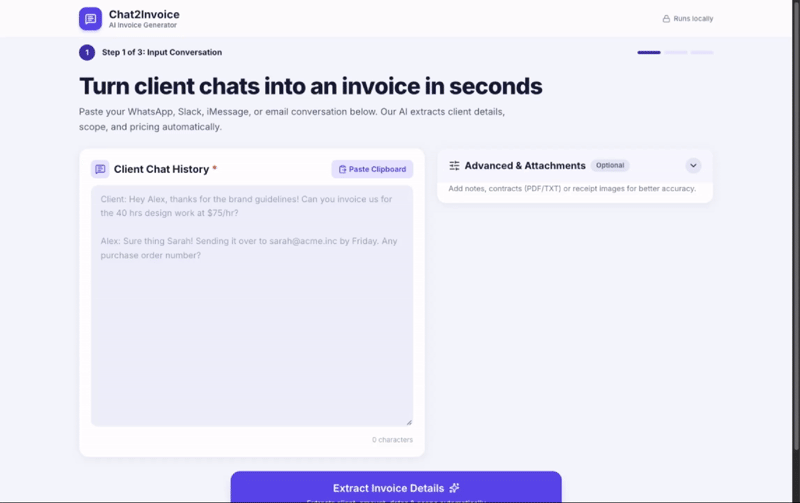

# Chat2Invoice

Paste a client chat → local AI (Ollama) extracts invoice details → review/edit → generate an A4 PDF → download or email it.



- **Stack:** Next.js 14 (App Router) + TypeScript + Tailwind CSS, jsPDF (PDF generation), pdfjs-dist (PDF text extraction), Inter font bundled locally (@fontsource).
- **Offline:** everything runs locally. Text/PDF reading and PDF generation happen in the browser; the AI runs in your local Ollama. Only "Send via Email" needs internet (Resend).

## Requirements
- Node.js **18.18+** (20 LTS recommended)
- [Ollama](https://ollama.com/download)

## Setup
```bash
# 1. Install Ollama, then pull the model (one time, ~3 GB)
ollama pull gemma3:latest

# 2. Install dependencies
cd chat2invoice
npm install

# 3. Environment
cp .env.example .env.local     # edit if needed
```

`.env.local`:
```dotenv
OLLAMA_AI_MODEL=gemma3:latest
OLLAMA_HOST=http://127.0.0.1:11434
# Optional – the "Send Invoice via Email" section only appears when BOTH are set:
RESEND_API_KEY=re_xxx
RESEND_SENDER_EMAIL=invoices@your-verified-domain.com
```
(Shell environment variables work too.) RESEND_SENDER_EMAIL must be on a domain verified in your Resend account.

## Run
```bash
npm run ai       # if Ollama isn't already running (desktop app starts it automatically)
npm run dev           # development → http://localhost:3000
# or production:
npm run build && npm start
```
Open from a phone on the same Wi-Fi: `npx next dev -H 0.0.0.0` then visit `http://<your-computer-ip>:3000`.

## How it works
1. **Input** – paste the chat (or "Paste Clipboard"). "Advanced & Attachments" (collapsed) adds notes that override the chat, plus PDF/TXT files (text extracted in the browser) and images (sent to the gemma3 vision model).
2. **Review** – missing required fields appear under *Action Needed* (due date has +7/+14/+30 quick picks); found ones are editable. Optional: discount, due now, tax note, currency, company names, payment instructions. Invoice ID (`INV-2026-OCT-13-JD2N`) and issue date are auto-generated; Due Now defaults to amount − discount.
3. **Ready** – preview, Download PDF, and (if Resend is configured) send the PDF to the client with an editable message.

API routes: `POST /api/extract` (proxies to Ollama with `format: "json"`, validates/cleans output, clear 503 error if Ollama is down), `POST /api/send` (Resend REST API with the PDF attached).
